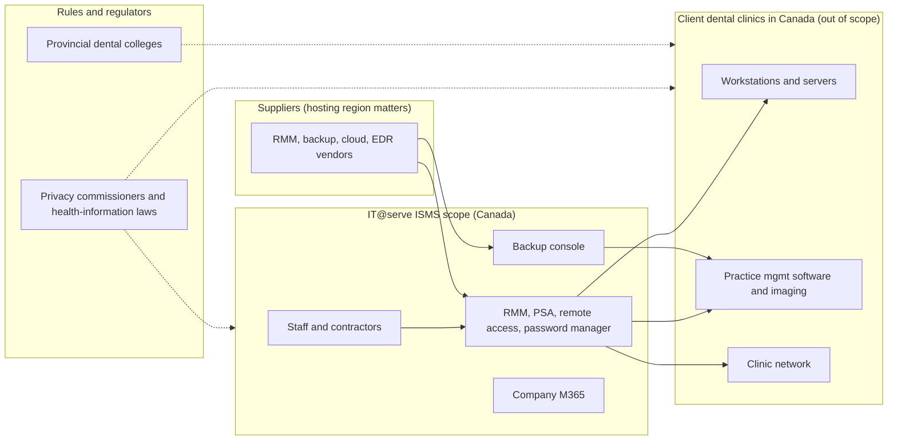

# ISMS Context and Scope: IT@serve Company

*Supports ISO/IEC 27001:2022 clauses 4.1 (context), 4.2 (interested parties), 4.3 (scope). Fictional organization. Part 1 of 3. Version 0.3 (revised for a Canadian focus), November 2026.*

## 1. Internal and external issues (Clause 4.1)

| Type | Issue | Impact on information security |
|---|---|---|
| Internal | Small team, staff wear many hats | Weak segregation of duties; key-person dependency |
| Internal | Shared tooling with access to all clients | Single compromise affects many clients |
| Internal | Remote-first and BYOD | Endpoint and home-network risk |
| Internal | Rapid growth plan (O3) | Onboarding and offboarding errors, process drift |
| External | Ransomware targeting healthcare and dental | High likelihood and impact |
| External | MSPs targeted as a route into many victims | Elevated threat to IT@serve itself |
| External | Client demand for evidence of security | Market driver for ISO 27001 |
| External | Dependence on cloud and software suppliers, some hosted outside Canada | Supplier outage or breach, and cross-border data transfer obligations |
| External | Canadian privacy and health-information laws that differ by province | Legal duty to protect patient data, support clinics' breach reporting, and sign provincial service-provider agreements |
| External | Provincial dental regulatory colleges set record-keeping and privacy standards | Clinics expect IT@serve to help them meet those standards |

## 2. Interested parties and requirements (Clause 4.2)

| Interested party | Needs and expectations |
|---|---|
| Dental clinics (clients) | Availability, confidentiality of patient data, fast incident notification, evidence of controls, contract terms that satisfy their legal duties |
| Clinics' patients (indirect) | Privacy of their health records |
| Employees | Clear policies, safe tools, training |
| Owners / investors | Business continuity, reputation, growth |
| Privacy regulators (federal and provincial commissioners) | Compliance with privacy law, breach reporting by the accountable organization, breach records |
| Provincial dental regulatory colleges | Clinics keep and protect patient records to professional standards |
| Provincial health authorities (where a province runs a shared health record) | Service providers sign and follow information-manager agreements |
| Cyber insurers | Proof of MFA, backups, EDR and incident process |
| Canadian Centre for Cyber Security | Source of threat information and baseline guidance (not a customer or regulator) |
| Suppliers (RMM, backup, cloud vendors) | Proper use of services, timely payment, contract compliance |
| Practice-software and imaging vendors | Remote access done per vendor requirements |

## 3. Scope statement (Clause 4.3)

> The ISMS of IT@serve Company covers the **provision of managed IT services to dental clinics in Canada**, including helpdesk, endpoint and network management, backup and recovery, cloud administration and onsite support. It covers all employees and contractors, the company's information systems and tools, the remote and office work locations, and the information of IT@serve and its clients that IT@serve accesses, stores or processes in delivering these services.

## 4. Applicable legal and contractual requirements

*Summary for a fictional Canadian MSP, checked November 2026. This is not legal advice. Laws change and differ by province, so a real organization must confirm each item with a lawyer or privacy officer and keep the list current (this feeds the legal requirements register, action TP-14 in Part 2).*

| Requirement | Applies because | Main points for IT@serve |
|---|---|---|
| **PIPEDA** (federal, *Personal Information Protection and Electronic Documents Act*) | Private-sector commercial activity and cross-border data flows. Provinces with a substantially similar law (Alberta, British Columbia, Québec) apply their own law to local activity | Breach of security safeguards: report to the Privacy Commissioner and notify affected individuals when there is a *real risk of significant harm*. **Keep a record of every breach for 24 months**, whether or not it is reported. The clinic is the accountable organization, so IT@serve must support it with prompt notice and information |
| **Provincial private-sector privacy laws** (for example Alberta PIPA, British Columbia PIPA) | Clinics and IT@serve as private-sector organizations in those provinces | Require reasonable security safeguards; Alberta has its own breach notification rule. Confirm the exact duties per province |
| **Provincial health-information laws** (for example Ontario PHIPA, Alberta HIA, Manitoba PHIA; other provinces have their own) | Clinics are "custodians" of patient health information | A service provider can be brought under the law by contract. In Alberta an **information manager** must work under an **Information Manager Agreement**. In Ontario a provider can be an **agent**, **electronic service provider** or **health information network provider**, each with obligations |
| **Québec Law 25** (*Act respecting the protection of personal information in the private sector*) | Clinics or data in Québec | In force since September 2024. Confidentiality incidents posing a **risk of serious injury** must be reported to the *Commission d'accès à l'information* and to the individuals, and recorded in an **incident register**. A **privacy impact assessment** is needed before personal information is communicated **outside Québec** (including to cloud or backup hosted elsewhere in Canada). Outsourcing contracts must include required terms |
| **Provincial dental regulatory colleges** | Dentists are licensed by provincial colleges | Standards of practice cover patient records and privacy. They bind the clinic, but clinics will expect IT@serve to support them (retention, access control, secure disposal) |
| **Client contracts and data processing terms** | Every managed service agreement | Security obligations, incident notice times, subcontractor (supplier) rules, data return and deletion at the end of the contract |
| **Cyber insurance conditions** | IT@serve and many clinics hold policies | Typical conditions: MFA, tested backups, EDR, incident process |
| **Canadian baseline cyber guidance** (non-legal) | Recognized by clinics and insurers | The Canadian Centre for Cyber Security *Baseline Cyber Security Controls for Small and Medium Organizations* (also the national standard behind the optional CyberSecure Canada certification, whose current status should be checked with the Standards Council of Canada) |

**Why this matters for the ISMS:** the Canadian rules turn into concrete requirements: a legal register, a breach-notification procedure with timelines, a 24-month breach record, service-provider agreements per province, and a cross-border transfer check for each supplier. These are carried into Parts 2 and 3.

## 5. Boundaries

### In scope

| Area | Included |
|---|---|
| People | All 12 employees, 2 contractors |
| Locations | Staff home offices, small office / staging room (in Canada) |
| Clients | Dental clinics located in Canada |
| Systems | RMM, PSA, remote access, password manager, backup console, company M365, staff laptops and phones |
| Client-facing activities | Remote and onsite administration of client systems |
| Information | Company data, client admin credentials, client network documentation, client patient data when accessed during support or stored in backups |
| Processes | Onboarding/offboarding (staff and clients), change, incident, backup, access, supplier management, breach notification support |

### Out of scope (with justification)

| Excluded | Justification |
|---|---|
| Physical security of clinic premises | Owned and controlled by each clinic. IT@serve advises only |
| Clinical systems' functionality and clinical decisions | Responsibility of clinic and software vendor |
| Client-owned data governance, patient consent and the clinic's own privacy program | The clinic is the accountable organization; IT@serve is a service provider that supports it |
| Clinics outside Canada | Not served in this scenario. US or other foreign health-privacy rules (for example HIPAA) are not assessed |
| Third-party SaaS internals (RMM, backup vendor) | Managed through supplier controls, not directly operated |

## 6. Interfaces and dependencies

## 7. Scope review

The scope is reviewed at least annually, and whenever there is a significant change (new service, new tooling, major growth, acquisition, entry into a new province, or a change in the law).

## 8. Sources used for the legal summary

- Breach of Security Safeguards Regulations (SOR/2018-64), Canada Gazette: https://gazette.gc.ca/rp-pr/p2/2018/2018-04-18/html/sor-dors64-eng.html
- Miller Thomson, service providers under PHIPA and Alberta HIA: https://www.millerthomson.com/en/?p=32389
- Québec Law 25 overview (DataGuidance): https://www.dataguidance.com/opinion/quebec-overview-law-25-part-one
- Canadian Centre for Cyber Security, baseline controls: https://cyber.gc.ca/en/guidance/baseline-cyber-security-controls-small-and-medium-organizations
- Oral Health, privacy in the dental practice: https://www.oralhealthgroup.com/features/privacy-in-the-dental-practice-bridging-the-gap-between-it-and-compliance
