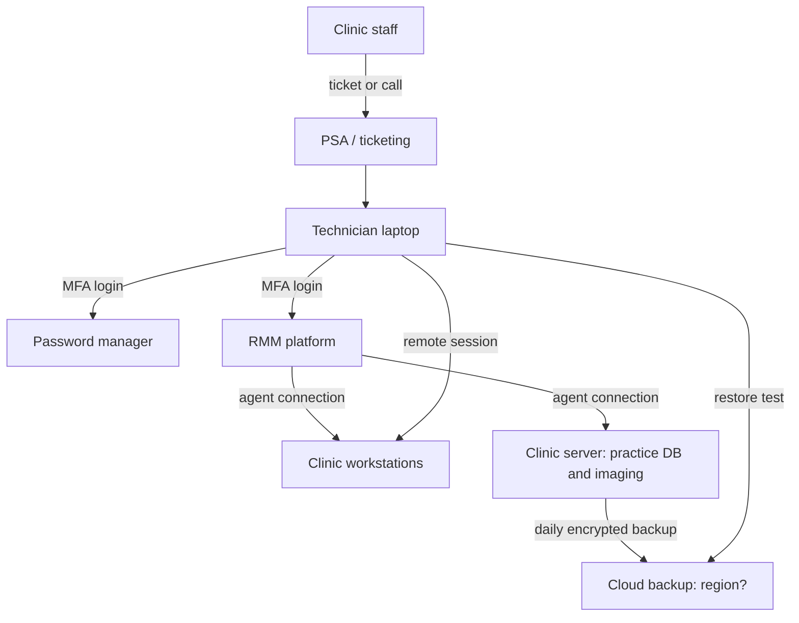

# Services, Data and Data Flows: IT@serve Company

*Input for the asset register and risk assessment (Part 2). Fictional organization. Part 1 of 3. Version 0.3 (revised for a Canadian focus), November 2026.*

## 1. Information handled

| Information type | Owner | Example | Classification | Impact if lost / leaked |
|---|---|---|---|---|
| Client admin credentials | Client / IT@serve | Server, firewall, M365 admin accounts | **Restricted** | Takeover of client environments |
| Patient data (personal health information) | Clinic | Records, X-rays, appointment data seen during support or in backups | **Restricted** | Privacy breach, breach reporting duties for the clinic, legal and reputational harm |
| Client network documentation | Client / IT@serve | Diagrams, IP plans, configs | **Confidential** | Aids attackers |
| Client contracts and billing | IT@serve | Agreements, invoices | **Confidential** | Commercial and legal harm |
| Staff HR data | IT@serve | Employment records | **Confidential** | Privacy breach |
| Internal procedures | IT@serve | Runbooks, policies | **Internal** | Low to moderate |
| Marketing material | IT@serve | Website content | **Public** | Low |

### Classification scheme

| Level | Meaning |
|---|---|
| Restricted | Highly sensitive; strict need-to-know, encryption required |
| Confidential | Sensitive business or personal data; access by role |
| Internal | For staff use only |
| Public | Approved for public release |

## 2. Key data flows

## 3. Where the data lives (Canadian residency and cross-border view)

IT@serve's objective O6 is to prefer Canadian hosting for client data. In practice each tool needs its hosting region checked.

| Tool or data store | Holds patient data? | Hosting region (to confirm per vendor) | Cross-border concern |
|---|---|---|---|
| Cloud backup platform | **Yes** (practice database and imaging copies) | Choose a Canadian region where offered | Highest priority: complete patient records |
| RMM platform | Indirect (device data, session access to systems with patient data) | Often outside Canada | Device and user data may leave Canada |
| Remote access tool | Indirect (screen content during sessions) | Often outside Canada | Session data may cross borders |
| PSA / ticketing | Possible (tickets may mention patients) | Often outside Canada | Staff must avoid patient details in tickets |
| Password manager | No patient data, but client credentials | Often outside Canada | Credentials give access to patient systems |
| Company Microsoft 365 | Possible (emails and files with client data) | Choose Canadian data residency for the tenant | Confirm tenant region |

**Rules of thumb for the ISMS:**

1. Keep patient data out of tickets and chat wherever possible.
2. For each supplier, record the hosting region and run a transfer assessment where the law needs one (for example Québec clients).
3. Record each supplier's region in the supplier register (action TP-10 in Part 2).

## 4. Critical dependencies (single points of failure)

| Dependency | Why critical | Initial concern |
|---|---|---|
| RMM platform | Admin-level control of all client endpoints | Compromise or misuse affects all clients |
| Password manager | Holds client admin credentials | Account takeover exposes everything |
| Backup platform | Last line of defence against ransomware | Backups deleted or encrypted; untested restores; hosted outside Canada |
| Remote access tool | Direct access into clinics | Hijacked sessions |
| Company M365 tenant | Email, files, identity | Phishing, account takeover |
| Key staff | Few people know each client | Staff loss, insider misuse |

## 5. Starting list of risk themes (to be developed in Part 2)

1. Compromise of RMM or remote access tooling (supply-chain attack on clients)
2. Phishing and credential theft against technicians
3. Ransomware at a client clinic, with failed or untested backups
4. Leak of patient data through misconfigured access or lost device
5. Excessive or lingering privileged access (offboarding failures)
6. Supplier outage or breach (RMM, backup, cloud vendors)
7. Unpatched client systems and unsupported software or imaging systems
8. Insider error or misuse
9. Loss of key personnel
10. Non-compliance with Canadian privacy, health-information, contract and breach-notification obligations (including keeping 24-month breach records and telling clinics promptly)
11. **New:** Cross-border transfer or hosting of patient data outside Canada without the assessments or contract terms that clinics and provincial law require
12. **New:** Missing or inconsistent provincial service-provider agreements (for example information manager or agent terms) with clinics

