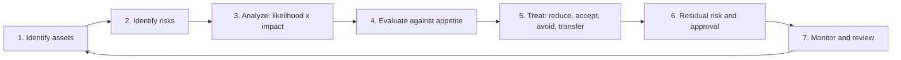

# Risk Assessment Methodology: IT@serve Company

*Supports ISO/IEC 27001:2022 clauses 6.1.2 (risk assessment) and 6.1.3 (risk treatment). Fictional Canadian organization. Part 2 of 3. Version 0.3 (revised for a Canadian focus), November 2026.*

## 1. Purpose and scope

This document defines how IT@serve identifies, analyzes, evaluates and treats information security risks so that results are **consistent, repeatable and comparable** over time. It applies to everything inside the ISMS scope (see `../01-scope-and-context/isms-scope.md`).

IT@serve is a Canadian provider of IT services to dental clinics, so the method also has to reflect **Canadian privacy and health-information duties**, which differ by province. Section 4 lists where those requirements come from, and the impact scale in step 3 includes legal impact. Nothing here is legal advice.

## 2. Roles

| Role | Responsibility |
|---|---|
| CEO (top management) | Approves this methodology, the risk appetite, and acceptance of residual risk |
| Security and Compliance Lead | Runs the process, maintains the registers and the legal requirements register, acts as privacy contact, reports to the CEO |
| Risk owners | Named managers accountable for a risk and its treatment |
| Asset owners | Provide asset value (C, I, A) and help identify risks |
| All staff | Report weaknesses, incidents and changes that may affect risk |

## 3. Process

### Step 1: Identify assets
Maintain the asset register (`asset-register.xlsx`). Each asset has an owner, a classification and ratings for **Confidentiality, Integrity and Availability** (1 to 5). Asset criticality is the highest of the three.

### Step 2: Identify risks
Use a **hybrid approach**: start from critical assets (asset-based) and add scenarios (e.g. ransomware, supplier breach). Each risk is written as **threat + vulnerability + consequence** and linked to the assets affected. Inputs include: threat information, incidents, supplier reviews (including each supplier's hosting region), audit findings, staff reports, client audit requests, and changes in Canadian privacy or health-information law or in regulator and dental-college guidance.

### Step 3: Analyze
Score **inherent risk** (current controls ignored where they are unproven) as:

> **Risk score = Likelihood (1 to 5) x Impact (1 to 5)**

Likelihood and impact scales are in the table below and in the `Settings` sheet of `risk-register.xlsx`. If a risk fits several impact categories, use the highest.

**Likelihood**

| Level | Label | Assumed frequency |
|---|---|---|
| 1 | Rare | Less than once in 5 years |
| 2 | Unlikely | Once in 3 to 5 years |
| 3 | Possible | Once in 1 to 3 years |
| 4 | Likely | About once a year |
| 5 | Almost certain | Several times a year |

**Impact**

| Level | Label | Patient / client data | Service availability | Financial (CAD) | Legal and reputation |
|---|---|---|---|---|---|
| 1 | Insignificant | No patient data | Under 1 hour, one clinic | Under $1k | None |
| 2 | Minor | Internal data only | Up to 4 hours, one clinic | $1k to $5k | Minor contract issue |
| 3 | Moderate | Limited patient data at one clinic; breach is recorded but the clinic need not report | Up to 1 business day, one clinic | $5k to $25k | SLA breach, client complaint |
| 4 | Major | Patient data at one or several clinics; the clinic must report to the privacy regulator and notify patients | 1 to 3 days at one clinic, or 1 day at several | $25k to $100k | Regulator notified, loss of a client |
| 5 | Severe | Large breach or multi-client compromise | Multi-day outage, several clinics | Over $100k or threatens the company | Regulatory investigation or enforcement, loss of several clients |

> All values are assumptions for a fictional company, in **Canadian dollars (CAD)**. A real organization should calibrate them with management and its contracts.

**Scoring privacy and legal impact in Canada**

- A privacy breach is impact **3** when limited patient data is involved and the clinic would only keep a record. It is impact **4 or higher** when the clinic must assess whether there is a real risk of significant harm, report to the privacy regulator and notify patients. This follows the federal private-sector rule. Provincial health-information laws and Québec law can set different thresholds, so check each province served.
- Every breach, whether reported or not, is recorded, and the record is kept for at least 24 months (federal rule). Missing records are themselves a compliance risk (R-10).
- Patient data hosted outside Canada, or outside Québec for a Québec clinic, is scored with higher likelihood and legal impact until the needed assessment and client approval are in place (R-15).

### Step 4: Evaluate

**5x5 matrix** (score = L x I)

| L \ I | 1 | 2 | 3 | 4 | 5 |
|---|---|---|---|---|---|
| **5** | 5 Medium | 10 High | 15 Critical | 20 Critical | 25 Critical |
| **4** | 4 Low | 8 Medium | 12 High | 16 Critical | 20 Critical |
| **3** | 3 Low | 6 Medium | 9 Medium | 12 High | 15 Critical |
| **2** | 2 Low | 4 Low | 6 Medium | 8 Medium | 10 High |
| **1** | 1 Low | 2 Low | 3 Low | 4 Low | 5 Medium |

| Rating | Score | Required action |
|---|---|---|
| Critical | 15 to 25 | Treat immediately. CEO owns the risk. Cannot be accepted |
| High | 10 to 14 | Treat within 90 days with a funded plan |
| Medium | 5 to 9 | Treat, or accept with documented owner approval. Review quarterly |
| Low | 1 to 4 | Accept and monitor. Review annually |

### Risk appetite statement

IT@serve has **low appetite** for risks that could expose patient data or interrupt clinic operations across multiple clients. After treatment, **residual risk must be Medium or lower**, and any Medium risk that is accepted needs the owner's written approval. Critical and High residual risks are not accepted.

### Step 5: Treat

| Option | Meaning | Example in this project |
|---|---|---|
| **Reduce** | Add or improve controls to lower likelihood or impact | MFA, immutable backups, Canadian hosting regions, province-specific agreements (most risks) |
| **Accept** | Knowingly tolerate the risk within appetite | PSA outage (R-13) |
| **Avoid** | Stop the activity that creates the risk | Ban privileged access from personal devices (R-14) |
| **Transfer** | Share the risk with another party | Cyber insurance, supplier contracts (R-03, R-06) |

Controls are chosen from ISO/IEC 27001:2022 Annex A (and may come from other sources where needed). The selected controls feed the **Statement of Applicability** in step 03. Each risk is also tagged with the closest **NIST CSF 2.0** category to prepare step 04.

### Step 6: Residual risk and approval
After the planned treatment, re-score likelihood and impact to get **residual risk**. Compare it with the appetite. The risk owner approves the residual risk; the CEO approves any Medium risk that is accepted and the overall treatment plan.

### Step 7: Monitor and review
- Full review **at least annually**.
- Triggered review after: a security incident, a major change (new tool, new service, acquisition), a significant supplier change, or an audit finding.
- Risk owners update status **quarterly**; the Security and Compliance Lead reports a summary to the CEO.

## 4. Sources of requirements (Canada)

Legal and contractual sources feed step 2 (identify risks) and the impact scale. The legal summary is in `../01-scope-and-context/isms-scope.md`, section 4, and is kept current in the legal requirements register (action TP-14).

| Source | Examples | Used for |
|---|---|---|
| Federal privacy law and the Privacy Commissioner of Canada | PIPEDA breach reporting, notification and 24-month breach records | Impact scale, R-10 |
| Provincial privacy law and commissioners | Private-sector privacy acts, Québec Law 25 and the *Commission d'accès à l'information* | R-10, R-15 |
| Provincial health-information laws | Ontario PHIPA, Alberta HIA, Manitoba PHIA and others, with their service-provider terms | R-16, TP-28 |
| Provincial dental regulatory colleges | Standards for patient records and privacy | Context for clinics' expectations, R-10 |
| Client contracts | Security duties, incident notice times, data return and deletion | R-10, R-16 |
| Cyber insurers | Conditions on MFA, backups, EDR, incident process | R-01, R-03 |
| Canadian Centre for Cyber Security | Threat information and baseline controls for small and medium organizations | Threat input, control choices |

## 5. Records

| Record | File |
|---|---|
| Asset register | `asset-register.xlsx` |
| Risk register, scoring, heat map | `risk-register.xlsx` |
| Risk treatment plan | `risk-treatment-plan.md` (updated in Part 3) |
| Statement of Applicability | `../03-iso27001-mapping/` (Part 3) |

## 6. Alignment with NIST CSF 2.0

| CSF 2.0 element | How it appears here |
|---|---|
| GV.RM (Risk Management Strategy) | Appetite statement, scales and thresholds in this document |
| GV.RR (Roles and Responsibilities) | Roles table in section 2 |
| ID.AM (Asset Management) | Asset register |
| ID.RA (Risk Assessment) | Risk identification, analysis and the risk register |
| ID.IM (Improvement) | Review triggers and periodic reassessment |
